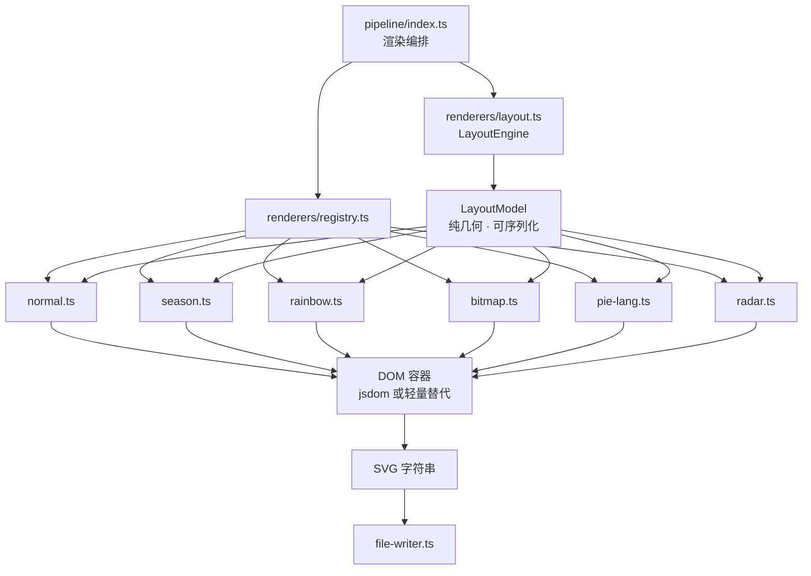

# 阶段 2:架构重构(Architecture)

| 元信息 | 值 |
|---|---|
| 优先级 | P1 |
| 分类 | **长期演进** —— 涉及删除 5 个文件并重命名大部分模块,属永久分叉内容,不可回流上游 |
| 工期 | 5 周 |
| 目标版本 | **minor**(如 `0.10.0`) |
| 前置条件 | **[阶段 0](./01-phase0-safety-net.md) 快照基线已合入(硬依赖)**;[阶段 1](./02-phase1-correctness.md) 已完成或已错开文件 |
| 风险等级 | **高** |

## 一、目标

解决 [总纲 A1](./README.md#21-架构层面) 与 [A3](./README.md#21-架构层面) 两个架构问题:

1. **消灭 `settings.type` 横向 switch** —— 新增主题从「改 6 个文件」降为「加 1 个文件 + 注册表一行」
2. **拆分渲染流水线** —— 布局与样式分离,10 次全量渲染降为 1 次布局 + N 次样式

预期收益:渲染提速 3~6 倍,渲染层可测性从 0% 提升到 ≥ 60%,扩展成本下降约 6 倍。

## 二、前置缺陷说明

当前 `settings.type` 判定散落 **3 个文件 29 处**:

| 文件 | 行号 | 处数 |
|---|---|---|
| `src/create-3d-contrib.ts` | `156`、`234`、`253`、`255`、`257`、`259`、`264`、`283`、`285`、`287`、`289`、`305`、`329`、`331`、`333`、`335` | 16 |
| `src/create-css-colors.ts` | `19`-`22`、`27`、`42`、`55`、`107`、`134` | 9 |
| `src/create-svg.ts` | `27`、`30`、`63`、`75` | 4 |

其中 `create-3d-contrib.ts` 的三段(顶面 `:253-261` / 左面 `:283-291` / 右面 `:329-337`)完全同构,是纯粹的三份复制。

## 三、目标架构



关键变化:`LayoutModel` 把「几何」与「主题」彻底解耦。`create-3d-contrib.ts:180-191` 的几何计算从「边遍历边画」改为「一次算完存成数组」,10 个 renderer 共享同一份 `LayoutModel`。

## 四、接口设计

> 以下为计划内容,尚未实现。完整定义以[附录](./appendix-target-architecture.md)为准。

### 4.1 Renderer 契约

```typescript
// src/renderers/types.ts(计划内容)
import type * as type from '../type';

export type SvgRoot = d3.Selection<SVGSVGElement, unknown, null, unknown>;

export interface RenderContext<T extends type.Settings = type.Settings> {
    readonly svg: SvgRoot;
    readonly userInfo: type.UserInfo;
    readonly settings: T;
    /** 由 LayoutEngine 一次性算出,全部 renderer 共享。独立画布类型可为 null */
    readonly layout: LayoutModel | null;
    /** 覆盖 settings.growingAnimation,用于 profile-*-animate.svg */
    readonly forceAnimation: boolean;
}

export interface Renderer<T extends type.Settings = type.Settings> {
    readonly type: T['type'];
    /** 该类型的画布尺寸,替代 create-svg.ts:10-18 的散落常量 */
    readonly canvas: { width: number; height: number };
    /** 是否需要 LayoutModel。pie_lang_only / radar_contrib_only 为 false */
    readonly needsLayout: boolean;
    /** 产出 CSS,含 @keyframes 与 @media (prefers-color-scheme: dark) */
    css(settings: T): string;
    /** 一次性资源,如 bitmap 的 <defs><pattern> */
    defs?(ctx: RenderContext<T>): void;
    /** 主体绘制,复用 ctx.layout */
    draw(ctx: RenderContext<T>): void;
}
```

### 4.2 LayoutModel

```typescript
// src/renderers/layout.ts(计划内容)
export interface LayoutCell {
    readonly date: Date;
    /** 0..4,对应 NONE..FOURTH_QUARTILE */
    readonly level: number;
    readonly contributionCount: number;
    /** 距首个周日的天数除以 7 */
    readonly week: number;
    /** 0=周日 .. 6=周六 */
    readonly dayOfWeek: number;
    readonly baseX: number;
    readonly baseY: number;
    /** 柱高,即 log10(count/20+1)*144+3 */
    readonly height: number;
    /** 季节主题用的周内模式号 0..19 */
    readonly seasonPattern: number;
}

export interface LayoutGeometry {
    readonly width: number;
    readonly height: number;
    readonly dx: number;
    readonly dy: number;
    readonly dxx: number;
    readonly dyy: number;
    readonly offsetX: number;
    readonly offsetY: number;
    readonly weekcount: number;
    readonly angle: number;
}

export interface LayoutModel {
    readonly cells: ReadonlyArray<LayoutCell>;
    readonly geometry: LayoutGeometry;
}
```

### 4.3 纯函数约束(强制的)

```typescript
// src/renderers/layout.ts(计划内容)
export const createLayoutEngine = (options?: LayoutOptions) => ({
    /** 必须为纯函数:相同输入必须产出完全相同的 LayoutModel(含全部浮点位) */
    layout(userInfo: type.UserInfo, width: number, height: number): LayoutModel | null,
});
```

这条约束是性能优化的正确性前提。若 `layout()` 读取了当前时间、随机数或依赖可变全局,则 10 个 renderer 各自的产物可能不一致,**快照测试会捕获到**。实现时须在 `layout.ts` 顶部注释标明此约束,并在 code review checklist 中列为必查项。

### 4.4 注册表

```typescript
// src/renderers/registry.ts(计划内容)
const registry = new Map<string, Renderer>();

export const registerRenderer = (renderer: Renderer): void => {
    if (registry.has(renderer.type)) {
        throw new Error(`E_DUPLICATE_RENDERER: renderer "${renderer.type}" 重复注册`);
    }
    registry.set(renderer.type, renderer);
};

export const getRenderer = <T extends type.Settings>(settings: T): Renderer<T> => {
    const found = registry.get(settings.type);
    if (!found) {
        throw new AppError(
            ErrorCode.SETTINGS_INVALID,
            `未注册的 settings.type: "${settings.type}"。可用类型: ${[...registry.keys()].join(' | ')}`,
        );
    }
    return found as Renderer<T>;
};

// 模块加载时自注册(副作用集中在 renderers/index.ts)
import './normal';
import './season';
import './rainbow';
import './bitmap';
import './pie-lang';
import './radar';
```

### 4.5 编排层

```typescript
// src/pipeline/index.ts(计划内容)
export interface RenderRequest {
    readonly userInfo: type.UserInfo;
    readonly settings: type.Settings;
    readonly forceAnimation: boolean;
}

export const renderSvg = (req: RenderRequest): string => {
    const renderer = getRenderer(req.settings);
    const { width, height } = renderer.canvas;
    const dom = createDomContainer(width, height);
    const svg = createSvgRoot(dom, width, height);

    svg.append('style').html(
        ['* { font-family: "Ubuntu", "Helvetica", "Arial", sans-serif; }', renderer.css(req.settings)].join('\n'),
    );
    renderer.defs?.({ svg, ...req, layout: null });
    svg.append('rect').attr('x', 0).attr('y', 0)
        .attr('width', width).attr('height', height).attr('class', 'fill-bg');

    const layout = renderer.needsLayout
        ? getLayoutEngine()(req.userInfo, width, height)
        : null;
    renderer.draw({ svg, ...req, layout });
    return dom.innerHtml();
};
```

> `renderer.defs?.({ svg, ...req, layout: null })` 中的 `layout: null` 是有意为之:`defs` 只依赖 `settings`(bitmap 的 `contribPatterns` 宽度),不依赖几何。此处是**计划实现**,首次落地时若类型检查不通过,改为先算 `layout` 再传 `defs` 亦可。

## 五、迁移映射

### 5.1 `create-3d-contrib.ts` 拆分去向

| 现有位置 | 内容 | 去向 |
|---|---|---|
| `:5` `ANGLE = 30` | 透视角常量 | `LayoutGeometry.angle`(阶段 4 可配置) |
| `:7-8` `toEpochDays` | epoch 天计算 | `renderers/layout.ts` 内部私有 |
| `:12-18` `addNormalColor` | normal 上色 | `renderers/normal.ts` |
| `:20-69` `decideSeasonPatternNo` | 季节模式号计算 | 移入 `LayoutCell.seasonPattern`(随布局预计算) |
| `:71-79` `addSeasonColor` | season 上色 | `renderers/season.ts` |
| `:81-98` `addRainbowColor` | rainbow 上色 + `parseFloat` | `renderers/rainbow.ts` |
| `:100-106` `addBitmapPattern` | bitmap 上色 | `renderers/bitmap.ts` |
| `:108` `atan` | skew 角度换算 | `renderers/layout.ts` 导出,供各 renderer 用 |
| `:110-150` `addPatternForBitmap` | `<pattern>` 生成 | `renderers/bitmap.ts` 的 `defs()` |
| `:152-164` `addDefines` | defs 入口 | `renderers/bitmap.ts` 的 `defs()` |
| `:166-352` `create3DContrib` | 主绘制 | 拆为 `layout.ts`(几何)+ 4 个 renderer(绘制) |
| `:180-191` 几何常量 | 布局常量 | `LayoutGeometry` |
| `:204` `calHeight` | 柱高公式 | `LayoutCell.height` |
| `:253-261`/`:283-291`/`:329-337` 三段 switch | 顶/左/右上色 | **消除**,改为 renderer 内部单点分派 |

### 5.2 `create-css-colors.ts` 拆分去向

| 现有位置 | 内容 | 去向 |
|---|---|---|
| `:4-6` `DARKER_*` 常量 | 三面明度系数 | `renderers/shared.ts`(阶段 4 可配置) |
| `:8-167` `createColors` | 主体 | 拆入各 renderer 的 `css()` |
| `:42-53` normal 分支 | 5 级 × 3 面 | `normal.ts` |
| `:55-105` season 分支 | 20 模式 × 5 级 × 3 面 | `season.ts` |
| `:107-132` bitmap 分支 | pattern 配色 | `bitmap.ts` |
| `:134-164` rainbow 分支 | 15 个 `@keyframes` | `rainbow.ts` |
| `:169-185` `createCssColors` | 暗色模式包裹 | `renderers/shared.ts` 的 `wrapDarkMode()` |

`create-css-colors.ts:18-40` 的 `.fill-strong` / `.fill-weak` / `.radar` 判定基于「是否属于 FullSettings」,迁移时按 renderer 的 `needsLayout` 与 `type` 归位。

### 5.3 `create-svg.ts` 拆分去向

| 现有位置 | 内容 | 去向 |
|---|---|---|
| `:10-18` 布局常量 | 画布尺寸 | 各 renderer 的 `canvas` 字段 |
| `:35-44` JSDOM + svg 根 | DOM 容器 | `renderers/dom.ts` 的 `createDomContainer` / `createSvgRoot` |
| `:46-51` `<style>` | 样式注入 | `pipeline/index.ts` |
| `:53` `addDefines` | defs | `renderer.defs?.()` |
| `:56-61` 背景 rect | 背景 | `pipeline/index.ts` |
| `:63-86` 独立画布分支 | pie / radar 单画布 | `pipeline/index.ts` 依据 `canvas` |
| `:89-122` 组合布局 | 3D + 雷达 + 饼 | `renderers/full-canvas.ts` |
| `:124-234` 统计数字与图标 | 文本渲染 | `renderers/footer.ts` |
| `:236` `container.html()` | 序列化 | `dom.ts` |

> `:124-234` 的统计数字块(总贡献 / star / fork + 图标 + 日期区间)在 6 种 renderer 中只有 `needsLayout` 为 true 的 4 种会用到,`pie_lang_only` / `radar_contrib_only` 不需要。迁移时需保留这一行为差异,否则会为独立画布多渲染 footer。

## 六、文件级改动清单

| 文件路径 | 动作 | 改动说明 |
|---|---|---|
| `src/renderers/types.ts` | NEW | `Renderer`、`RenderContext`、`SvgRoot` 接口 |
| `src/renderers/layout.ts` | NEW | `LayoutEngine`、`LayoutModel`、`LayoutCell`、`LayoutGeometry`、`createLayoutEngine`、`atan` |
| `src/renderers/registry.ts` | NEW | 注册表、`registerRenderer`、`getRenderer` |
| `src/renderers/shared.ts` | NEW | `wrapDarkMode`、`DARKER_*`、通用 CSS 前缀 |
| `src/renderers/dom.ts` | NEW | `createDomContainer`、`createSvgRoot`、序列化 |
| `src/renderers/normal.ts` | NEW | normal renderer |
| `src/renderers/season.ts` | NEW | season renderer |
| `src/renderers/rainbow.ts` | NEW | rainbow renderer |
| `src/renderers/bitmap.ts` | NEW | bitmap renderer(含 `defs`) |
| `src/renderers/pie-lang.ts` | NEW | `pie_lang_only` renderer |
| `src/renderers/radar.ts` | NEW | `radar_contrib_only` renderer |
| `src/renderers/full-canvas.ts` | NEW | 4 种 FullSettings 的组合画布(3D + 雷达 + 饼 + footer) |
| `src/renderers/footer.ts` | NEW | 统计数字、star/fork 图标、日期区间 |
| `src/renderers/index.ts` | NEW | 触发自注册的副作用入口 |
| `src/pipeline/index.ts` | NEW | `renderSvg`、`RenderRequest` |
| `src/create-3d-contrib.ts` | MODIFY→DELETE | 逐步瘦身为 `export { create3DContrib } from './renderers/full-canvas'` 过渡,最终删除 |
| `src/create-css-colors.ts` | MODIFY→DELETE | 同上,最终删除 |
| `src/create-svg.ts` | MODIFY→DELETE | 保留薄兼容层 `createSvg = renderSvg`,过渡期后删除 |
| `src/create-pie-language.ts` | MODIFY→DELETE | 迁入 `pie-lang.ts`,保留 `createPieLanguage` 导出以供 `full-canvas` 调用 |
| `src/create-radar-contrib.ts` | MODIFY→DELETE | 迁入 `radar.ts` |
| `src/index.ts` | MODIFY | 用 `pipeline` 替换 `create.createSvg`;`LayoutModel` 跨主题复用 |
| `spec/layout.spec.ts` | NEW | 几何纯函数单测,不依赖 DOM |
| `spec/renderers/*.spec.ts` | NEW | 各 renderer 的 CSS / canvas 单测 |
| `scripts/perf-baseline.ts` | NEW | 记录渲染耗时与产物体积,供前后对比 |

> **删除策略**:`create-3d-contrib.ts` / `create-css-colors.ts` / `create-svg.ts` / `create-pie-language.ts` / `create-radar-contrib.ts` 的删除统一安排在**最后**,且必须确认 `spec/` 中无任何引用。过渡期保留薄 re-export 层,避免跨 commit 断裂。

## 七、迁移顺序(关键)

严格按此顺序,每步结束后快照必须全绿:

| 步骤 | 动作 | 快照门禁 |
|---|---|---|
| 1 | 抽出 `dom.ts` + `layout.ts`,`createSvg` 内部改为调用它们,**不改变注册与分派方式** | 必须全绿 |
| 2 | 新增 `types.ts` + `registry.ts` + `index.ts`,注册 6 个 adapter,adapter 内部仍调用现有 `create*` 函数 | 必须全绿 |
| 3 | `full-canvas.ts` 接管 `createSvg` 的完整分支逻辑 | 必须全绿 |
| 4 | 迁移 `normal` → 删 `create-css-colors` 中 normal 分支 | 必须全绿 |
| 5 | 迁移 `season` | 必须全绿 |
| 6 | 迁移 `bitmap`(含 `defs`) | 必须全绿 |
| 7 | 迁移 `rainbow` | 必须全绿 |
| 8 | 迁移 `pie_lang_only` | 必须全绿 |
| 9 | 迁移 `radar_contrib_only` | 必须全绿 |
| 10 | 删除 5 个旧文件,清理 `index.ts` | 必须全绿 |
| 11 | `layout()` 跨主题复用(性能优化本体) | 必须全绿 |

> **步骤 11 是唯一的性能收益点**,前 10 步是纯结构重构。刻意放在最后,确保「先等价、再优化」,任何一步出问题都能立刻定位。

## 八、commit 切分

| # | commit message | 对应步骤 | 门禁 |
|---|---|---|---|
| 1 | `refactor: extract DOM container and layout engine` | 1 | 快照全绿 |
| 2 | `refactor: introduce renderer contract and registry` | 2 | 快照全绿 |
| 3 | `refactor: move full-canvas composition out of create-svg` | 3 | 快照全绿 |
| 4 | `refactor: migrate normal renderer` | 4 | 快照全绿 |
| 5 | `refactor: migrate season renderer` | 5 | 快照全绿 |
| 6 | `refactor: migrate bitmap renderer` | 6 | 快照全绿 |
| 7 | `refactor: migrate rainbow renderer` | 7 | 快照全绿 |
| 8 | `refactor: migrate pie_lang_only renderer` | 8 | 快照全绿 |
| 9 | `refactor: migrate radar_contrib_only renderer` | 9 | 快照全绿 |
| 10 | `refactor: remove legacy create-* modules` | 10 | 快照全绿 + 覆盖率达标 |
| 11 | `perf: reuse single LayoutModel across all themes` | 11 | 快照全绿 + 性能数据 |
| 12 | `test: add layout engine unit tests` | — | 覆盖率 ≥ 60% |
| 13 | `docs: document renderer contract and extension guide` | — | — |

> 每个 commit 独立可合并、独立可 Review。commit 1~9 若任意一个快照失败,**立即停止**并回退该 commit,不要继续往下做。

## 九、测试策略

| 层次 | 范围 | 目标 |
|---|---|---|
| 几何纯函数 | `layout.ts` | ≥ 90% 行覆盖 |
| renderer CSS | 各 `css()` 输出字符串 | 各 ≥ 80% |
| registry | 注册、重复注册、未知类型报错 | 100% |
| 端到端快照 | 16 份既有基线 | 全绿 |
| 性能 | `scripts/perf-baseline.ts` | 重构后 ≥ 3× 提速 |

### 几何单测必测边界

- `firstDate.getUTCDay() !== 0`(首日非周日)—— 回归 `0.9.1` 修复过的缺陷
- `contributionCalendar.length` 为 364 / 371 / 372
- `contributionCount` 为 0(避免 `Math.log10(0)` → `-Infinity`)
- `weekcount` 与 `offsetY` 的一致性
- 跨年边界:12 月 31 日与 1 月 1 日相邻的 week 递增
- **纯函数性**:同一 `UserInfo` 连续调用两次结果 `toEqual`

## 十、验收标准

- [ ] 16 份既有快照**原样**全绿
- [ ] `src/create-3d-contrib.ts`、`create-css-colors.ts`、`create-svg.ts`、`create-pie-language.ts`、`create-radar-contrib.ts` 已删除,`spec/` 无残留引用
- [ ] `src/` 中 `settings.type ===` / `settings.type ==` 的出现次数为 **0**
- [ ] 新增一种测试主题只需 2 个文件(`foo.ts` + `index.ts` 一行 import),不触碰其他文件
- [ ] 渲染层测试覆盖率 ≥ 60%,`layout.ts` ≥ 90%
- [ ] `scripts/perf-baseline.ts` 测得 10 主题渲染耗时相比重构前缩短 ≥ 3 倍
- [ ] `LayoutModel` 纯函数性测试通过
- [ ] `action.yml` 无需修改,`dist/` 构建通过 CI 一致性校验
- [ ] 产出的 SVG **在语义与视觉上** 与 `docs/demo/` 下 10 个 demo 一致(人工比对)

## 十一、回滚方案

本阶段风险最高,回滚须精细:

| 回滚粒度 | 操作 | 影响 |
|---|---|---|
| 单个 renderer 迁移 | revert 对应 commit(4~9) | 仅该主题回到旧实现,其余已迁移主题不受影响。**因步骤 2 已有 adapter 层,回滚任一 renderer 不会破坏架构** |
| 整阶段回滚 | revert commit 1~11 | 完全回到阶段 1 状态。`dist/` 需重新构建 |
| 性能优化回滚 | 单独 revert commit 11 | 保留结构重构,放弃 3~6 倍提速。**这是风险最低的降级选项** |
| 架构回滚但保留测试 | revert 1~11,保留 commit 12 | 失去重构但保住质量门禁 |

**关键提示**:若仅性能不达预期,优先 `revert commit 11`,而非整阶段回退 —— 结构重构本身对代码质量是净收益。

## 十二、风险

| 风险 | 等级 | 缓解 |
|---|---|---|
| **SVG 输出漂移** | **高** | 阶段 0 快照基线为硬门禁;7 步迁移每步必跑;发现漂移立即 revert 当步;切勿「顺手调整一下再跑」 |
| 浮点精度差异 | 中 | `layout()` 集中使用 `util.toFixed`(2 位小数),禁止在 renderer 内做额外算术;若发现差异,检查是否绕过了 `toFixed` |
| 元素顺序变化 | 中 | `full-canvas.ts` 必须严格保持 `create-svg.ts:56-234` 的 append 顺序 |
| 跨 commit 断裂 | 中 | 步骤 2 引入的 adapter 层是关键缓冲,不可跳过 |
| `tsconfig` 的 `rootDir: "./"` | 低 | 新增子目录不改变输出结构,`ncc build dist0/index.js` 不受影响 |
| 性能优化不达预期 | 低 | 步骤 11 独立可 revert |
| 与阶段 3 边界模糊 | 低 | 本阶段只做 `needsLayout` 内的主题扩展,配置分层留到阶段 3 |

## 十三、出口条件

- [ ] 全部 13 个 commit 合入,minor 版本发布
- [ ] `src/` 中 `settings.type` 判定归零
- [ ] 16 份快照全绿,性能提速 ≥ 3 倍
- [ ] 已发布「如何新增一个主题」的开发文档(commit 13)
