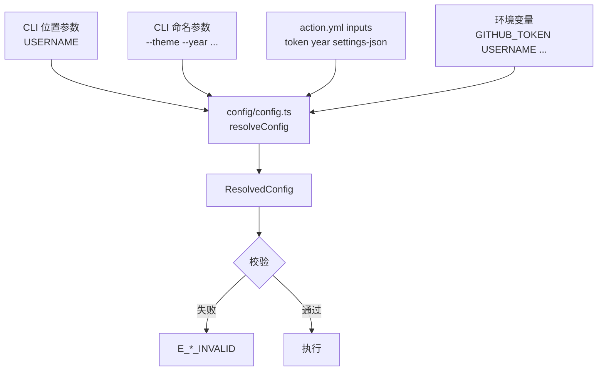

# 阶段 3:配置体系与 API 层(Config & API)

| 元信息 | 值 |
|---|---|
| 优先级 | P1 |
| 分类 | **长期演进** —— 配置分层与 API 层抽象。前置依赖阶段 2 的 `Renderer` 契约 |
| 工期 | 4 周 |
| 目标版本 | **minor** |
| 前置条件 | [阶段 2](./03-phase2-architecture.md) 已完成(`Renderer` / `LayoutModel` 契约稳定) |
| 风险等级 | 中 |

## 一、目标

解决 [总纲 A2](./README.md#21-架构层面) 与 [A5](./README.md#21-架构层面):

1. **配置分层** —— 建立 `CLI > action inputs > env > 默认值` 的统一解析,取代当前「env + 一个位置参数」
2. **API 客户端抽象** —— `GitHubClient` 类,统一错误分类、重试、限流预检;`endpoint` 改为构造注入

预期收益:错误信息可操作化;`endpoint` 可在运行时切换(测试友好);GitHub 限流从「神秘失败」变为「明确告知重置时间」。

## 二、配置分层设计

### 2.1 优先级链



冲突处理原则:

| 场景 | 行为 |
|---|---|
| 同一字段由多层提供 | 高优先级覆盖低优先级 |
| 高优先级显式置空(如 `--theme ""`) | **报错**,而非静默回退到低优先级 |
| 冲突且用户未预期 | 在 stderr 输出一条 `::notice::` 说明「`--year` 覆盖了 env `YEAR=...`」 |
| 多个层级都未提供 | 使用默认值;若该字段无默认值则报 `E_*_MISSING` |

### 2.2 字段表

| 字段 | CLI | input | env | 默认值 | 校验 |
|---|---|---|---|---|---|
| `token` | `--token` | `token` | `GITHUB_TOKEN` | 无(必填) | 非空字符串 |
| `username` | 位置参数 | `username` | `USERNAME` | 无(必填) | 非空字符串 |
| `endpoint` | `--endpoint` | `endpoint` | `GITHUB_ENDPOINT` | `https://api.github.com/graphql` | 合法 URL |
| `maxRepos` | `--max-repos` | `max-repos` | `MAX_REPOS` | `100` | 整数,1~1000 |
| `year` | `--year` | `year` | `YEAR` | `null` | 整数,1970~当前年 |
| `settingsFile` | `--settings-json` | `settings-json` | `SETTING_JSON` | `null` | 路径存在且可读 |
| `outDir` | `--out-dir` | `out-dir` | — | `./profile-3d-contrib` | 非空路径 |
| `themes` | `--theme` | `themes` | — | 内置 10 个 | 逗号分隔,每项须为已注册 type |
| `dryRun` | `--dry-run` | `dry-run` | — | `false` | 布尔 |
| `apiVersion` | `--api-version` | `api-version` | `GITHUB_API_VERSION` | 由 `action.yml` 提供 | `YYYY-MM-DD` 格式 |

`apiVersion` 是本阶段**新增**的字段,用于对接不同 GitHub Enterprise Server 版本。默认由 `action.yml` 的 `env` 提供,`@actions/*` 会注入 `GITHUB_API_VERSION`。

### 2.3 ResolvedConfig

```typescript
// src/config/config.ts(计划内容)
export interface ResolvedConfig {
    readonly token: string;
    readonly username: string;
    readonly endpoint: string;
    readonly apiVersion: string;
    /** 强制 1..1000,阶段 1 已实装截断 */
    readonly maxRepos: number;
    /** 强制 1970..当年 */
    readonly year: number | null;
    readonly settingsFile: string | null;
    readonly outDir: string;
    /** 内置主题名列表,与 settingsFile 互斥 */
    readonly themes: ReadonlyArray<string>;
    readonly dryRun: boolean;
    /** 记录每字段的实际来源,供调试与测试断言 */
    readonly sources: Readonly<Record<ConfigKey, ConfigSource>>;
}
```

`ConfigSource` 取值 `cli` / `input` / `env` / `default`。`sources` 字段使「某个值到底从哪来」可被测试断言,也使 `--help` 的调试输出有据可依。

## 三、CLI 设计

使用 Node 24 内置的 `node:util.parseArgs`,**零新增依赖**。

```typescript
// src/cli/index.ts(计划内容)
import { parseArgs } from 'node:util';

const OPTIONS = {
    token:         { type: 'string' },
    username:      { type: 'string' },
    endpoint:      { type: 'string' },
    'api-version': { type: 'string' },
    'max-repos':   { type: 'string' },
    year:          { type: 'string' },
    'settings-json': { type: 'string' },
    'out-dir':     { type: 'string' },
    theme:         { type: 'string', multiple: true },
    'dry-run':     { type: 'boolean', default: false },
    help:          { type: 'boolean', default: false },
    version:       { type: 'boolean', default: false },
} as const;

export const parseCli = (argv: ReadonlyArray<string>) => parseArgs({ args: argv, options: OPTIONS, allowPositionals: true });
```

### 3.1 `--help` 文案草案

```text
github-profile-3d-contrib —— 生成 3D 贡献日历 SVG

用法:
  node dist/index.js [USERNAME] [选项]

位置参数:
  USERNAME              目标 GitHub 用户名

选项:
  --token <token>       访问令牌 (env: GITHUB_TOKEN)
  --endpoint <url>      GraphQL 端点 (env: GITHUB_ENDPOINT)
  --api-version <date>  GitHub API 版本 YYYY-MM-DD (env: GITHUB_API_VERSION)
  --max-repos <n>       最多统计的仓库数,1~1000,默认 100 (env: MAX_REPOS)
  --year <yyyy>         指定年份以生成历史日历 (env: YEAR)
  --settings-json <p>   主题设置 JSON 路径 (env: SETTING_JSON)
  --theme <list>        内置主题名,逗号分隔或可重复
                        可选: normal, season, season-south, night-view,
                              night-green, night-rainbow, gitblock
  --out-dir <dir>       输出目录,默认 ./profile-3d-contrib
  --dry-run             仅打印将要生成的文件,不实际写入
  --help                显示本帮助
  --version             显示版本号

配置优先级: CLI 选项 > action inputs > 环境变量 > 默认值

示例:
  node dist/index.js octocat --theme gitblock,night-green
  node dist/index.js octocat --year 2024 --out-dir ./out --dry-run

更多信息见 https://github.com/YOUR_GITHUB_USER/YOUR_GITHUB_REPO
```

### 3.2 主题名与 `settings.type` 的映射

`--theme` 用**友好名**而非内部 `type`,因为内部类型名(`season` / `normal`)与输出文件名(`profile-season-animate.svg` / `profile-green.svg`)的对应关系不明显。

| `--theme` 名 | 内部 `type` | 无动画输出文件 |
|---|---|---|
| `normal` | `normal` | `profile-green.svg` |
| `season` | `season`(北半球) | `profile-season.svg` |
| `season-south` | `season`(南半球,需 `hemisphere: "south"` 覆写) | `profile-south-season.svg` |
| `night-view` | `normal` | `profile-night-view.svg` |
| `night-green` | `normal` | `profile-night-green.svg` |
| `night-rainbow` | `rainbow` | `profile-night-rainbow.svg` |
| `gitblock` | `bitmap` | `profile-gitblock.svg` |

> `season` 与 `season-south` 共用内部 `type:'season'`,通过 `src/settings/SouthSeasonSettings.json` 的内容区分,不需要新增 `type`。`night-view` / `night-green` 同理共用 `type:'normal'`。这正是阶段 2 注册表带来的好处:**内部 type 与用户可见名称解耦**。

`--theme` 与 `--settings-json` **互斥**,同时给出时报 `E_CONFIG_CONFLICT`。

## 四、action.yml 设计

```yaml
# action.yml(计划内容)
name: GitHub-Profile-3D-Contrib
description: Generate profile 3D Contributions
author: YOUR_GITHUB_USER

inputs:
  username:
    description: '目标 GitHub 用户名。留空时回退到 env USERNAME,再回退到仓库 owner'
    required: false
  token:
    description: '访问令牌。留空时回退到 env GITHUB_TOKEN(即 secrets.GITHUB_TOKEN)'
    required: false
  year:
    description: '指定年份以生成历史日历'
    required: false
  max-repos:
    description: '最多统计的仓库数,1~1000'
    required: false
  settings-json:
    description: '主题设置 JSON 文件路径'
    required: false
  themes:
    description: '内置主题名,逗号分隔。留空则使用默认 10 个主题'
    required: false
  out-dir:
    description: '输出目录'
    required: false
  endpoint:
    description: 'GitHub GraphQL 端点,用于 GitHub Enterprise'
    required: false

runs:
  using: 'node24'
  main: 'dist/index.js'
  post: 'dist/cleanup.js'

branding:
  icon: 'box'
  color: 'green'
```

> **`post` 步骤说明**:当前项目无 `post` 钩子。若后续引入 API 缓存(P5),需要用它清理临时文件。在 P5 之前**不要**添加,否则会因找不到 `dist/cleanup.js` 而使 Action 失败。

### 4.1 向后兼容:env 全部保留

> 坐标变更(`yoshi389111/...` → `YOUR_GITHUB_USER/YOUR_GITHUB_REPO`)已在 `1.0.0` 完成,
> 本节只讨论 `env:` 与 `with:` 的写法差异。

```yaml
# 旧写法,必须继续可用(计划内容)
- uses: YOUR_GITHUB_USER/YOUR_GITHUB_REPO@latest
  env:
    GITHUB_TOKEN: ${{ secrets.GITHUB_TOKEN }}
    USERNAME: ${{ github.repository_owner }}
```

```yaml
# 新写法(计划内容)
- uses: YOUR_GITHUB_USER/YOUR_GITHUB_REPO@latest
  with:
    username: ${{ github.repository_owner }}
  env:
    GITHUB_TOKEN: ${{ secrets.GITHUB_TOKEN }}
```

`GITHUB_TOKEN` 仍必须走 `env`(`inputs.token` 作为可选补充,便于本地用 `with:` 传入),README 需说明这一点。

## 五、GitHubClient 设计

### 5.1 现状问题回顾

```typescript
// src/github-graphql.ts:4-5(现状)
export const URL =
    process.env.GITHUB_ENDPOINT || 'https://api.github.com/graphql';
```

模块加载期求值 → 测试无法运行时切换。无重试、无超时、无错误分类。`errors?: [{...}]` 误标为 1 元组。分页逻辑(`:193-209`)与请求构造混杂。

### 5.2 错误分类学

```typescript
// src/github/errors.ts(计划内容)
export type ApiErrorKind =
    | 'AUTH'            // 401/403 或 GraphQL "Bad credentials"
    | 'RATE_LIMIT'      // 403 + X-RateLimit-Remaining: 0,或 "rate limit exceeded"
    | 'NOT_FOUND'       // 404,或 GraphQL "Could not resolve to a User"
    | 'GRAPHQL'         // 200 + errors 字段
    | 'SCHEMA_DRIFT'    // 200 + errors,但 type 属未识别的错误类型
    | 'NETWORK';        // 超时、DNS、5xx

export interface ApiErrorDetail {
    readonly kind: ApiErrorKind;
    readonly message: string;
    /** GraphQL errors[].path,不含仓库名,安全可打印 */
    readonly paths: ReadonlyArray<string>;
    /** 仅当 kind === 'RATE_LIMIT' */
    readonly resetAt?: Date;
    readonly status?: number;
    readonly retryable: boolean;
}
```

`SCHEMA_DRIFT` 单列的原因:GitHub 修改 GraphQL schema 时,`errors[].type` 会变成陌生值。此时应提示「可能是 GitHub 变更了 API,或需要设置 `GITHUB_API_VERSION`」,而不是笼统的「请求失败」。这是 GitHub Action 面向大量用户的项目必须处理的场景。

### 5.3 客户端接口

```typescript
// src/github/client.ts(计划内容)
export interface GitHubClientOptions {
    readonly token: string;
    readonly endpoint: string;
    readonly apiVersion: string;
    /** 指数退避重试次数上限,默认 3 */
    readonly maxRetries?: number;
    /** 单请求超时,默认 30s */
    readonly timeoutMs?: number;
    /** 注入以便测试;默认使用 globalThis.fetch */
    readonly fetchImpl?: typeof fetch;
}

export interface RateLimitInfo {
    readonly limit: number;
    readonly remaining: number;
    readonly cost: number;
    readonly resetAt: Date;
}

export class GitHubClient {
    constructor(options: GitHubClientOptions);

    /** 限流预检。remaining 不足 cost 时抛出 E_GITHUB_RATE_LIMIT 并附 resetAt */
    queryRateLimit(): Promise<RateLimitInfo>;

    /** 统一查询入口,自动做错误分类与重试 */
    query<T>(document: string, variables?: Record<string, unknown>): Promise<T>;

    /** 分页迭代器,取代当前的 fetchFirst / fetchNext / fetchData 三段式 */
    paginate<T>(
        extract: (data: T) => { nodes: T[]; cursor: string | null },
        variables?: Record<string, unknown>,
    ): AsyncGenerator<T[], void, undefined>;

    /** 一次性取回全部数据(内部组合 query + paginate) */
    fetchContributionData(args: { userName: string; maxRepos: number; year: number | null }): Promise<ContributionData>;
}
```

### 5.4 重试策略

仅对 `retryable: true` 的错误重试,采用**指数退避 + 抖动**:

| 错误 | 可重试 | 退避 |
|---|---|---|
| `NETWORK`(超时 / 5xx) | 是 | `1s → 2s → 4s` + 0~500ms 抖动 |
| `RATE_LIMIT` | 是,但**仅当** `resetAt` 距今 < 60s | 等待至 `resetAt` + 抖动 |
| `RATE_LIMIT`(重置时间较远) | **否** | 立即抛 `E_GITHUB_RATE_LIMIT` |
| `AUTH` | 否 | 立即抛,提示检查 token 权限 |
| `NOT_FOUND` | 否 | 立即抛,提示检查用户名 |
| `GRAPHQL` / `SCHEMA_DRIFT` | 否 | 立即抛,附 paths |

抖动是必需的:GitHub 的定时任务是全网同时触发的(常见 cron 是 `0 18 * * *`),无抖动会导致所有用户在同一毫秒重试,形成尖峰。

### 5.5 分页迭代器

现有 `fetchData` 的三个缺陷一并消除:

1. `maxRepos` 语义失效(阶段 1 已修)
2. `if (repos2.nodes.length !== maxReposOneQuery) break;` 的判断依赖「恰好等于 100」这一隐含假设
3. 错误时 `if (res2.data) ... else break;` 静默中断,把 API 错误伪装成「数据到此为止」

```typescript
// src/github/client.ts(计划内容)
async *paginate<T>(extract, variables = {}) {
    let cursor: string | null = null;
    let page = 0;
    const seen = new Set<string>();
    do {
        const data: T = await this.query(PAGINATE_DOCUMENT, { ...variables, after: cursor });
        const { nodes, cursor: next } = extract(data);
        for (const node of nodes) {
            if (seen.has(node.id)) break;  // 防御游标回绕导致的死循环
            seen.add(node.id);
            yield node;
        }
        // 分页终止以 hasNextPage 为准,不依赖「长度恰好等于 100」
        if (!extract(data).hasNextPage) return;
        cursor = next;
    } while ((page += 1) < MAX_PAGES);
}
```

**关键设计变更**:GraphQL 查询中增加 `pageInfo { hasNextPage endCursor }`,用 `hasNextPage` 判定终止,而不是「返回数量是否等于 100」。这是 GraphQL 官方推荐做法,也顺带修掉了 `maxRepos` 与分页逻辑的耦合。

### 5.6 是否弃用 axios

| 方案 | 收益 | 代价 | 建议 |
|---|---|---|---|
| 保留 axios,加拦截器 | 改动最小 | 保留 `follow-redirects` / `form-data` / `proxy-from-env` 依赖 | 可接受 |
| 改用 Node 24 内置 `fetch` | 少 3 个传递依赖,体积下降,超时/Abort 原生 | 需重写错误处理;`fetch` 不自动抛 HTTP 错误,需显式判 `res.ok` | **推荐** |

鉴于 `0.9.2` 有「为规避 `undici` 漏洞移除依赖」的明确前例,继续瘦身符合项目既定策略。但 `fetch` 在旧 Node 上需要 polyfill,而 `action.yml` 已是 `node24`,**无兼容负担**。因此建议在本阶段一并迁移到 `fetch`,并保留 `fetchImpl` 注入点以免测试受阻。

## 六、文件级改动清单

| 文件路径 | 动作 | 改动说明 | 涉及符号 |
|---|---|---|---|
| `src/config/config.ts` | NEW | `resolveConfig`、`ResolvedConfig`、`ConfigKey`、`ConfigSource` | — |
| `src/config/validate-config.ts` | NEW | 数值范围与 URL 校验 | — |
| `src/cli/index.ts` | NEW | `parseCli`、`OPTIONS`、帮助文案 | — |
| `src/github/client.ts` | NEW | `GitHubClient` 类、`query`、`paginate` | — |
| `src/github/errors.ts` | NEW | `ApiErrorKind`、`classifyHttpError`、`classifyGraphQLErrors` | — |
| `src/github/retry.ts` | NEW | 指数退避 + 抖动 | — |
| `src/github/documents.ts` | NEW | GraphQL 文档常量(替代 `github-graphql.ts:95-140` 内联字符串) | — |
| `action.yml` | MODIFY | 新增 `inputs`;`runs` 不变(不加 `post`) | — |
| `src/index.ts` | MODIFY | 改用 `resolveConfig`;`main` 签名不变 | `main` |
| `src/github-graphql.ts` | MODIFY→DELETE | `fetchData` 保留为 `GitHubClient.fetchContributionData` 的薄封装,过渡后删除;类型迁移至 `documents.ts` | `ResponseType` 等 |
| `schema/settings.schema.json` | MODIFY | 阶段 1 的告警模式**转为阻断式**;`$id` 与 `darkMode.type` 一致性约束写为 `allOf`/`if-then` | — |
| `spec/config.spec.ts` | NEW | 优先级链、冲突处理、范围校验 | — |
| `spec/github/client.spec.ts` | NEW | 错误分类矩阵、退避、分页边界、限流 | — |
| `README.md` + 10 份翻译 | MODIFY | 新增 `with:` 用法、优先级说明、`MAX_REPOS` 语义变更说明 | — |

## 七、commit 切分

| # | commit message | 内容 |
|---|---|---|
| 1 | `refactor: extract GraphQL documents into constants` | 纯提取,无行为变化 |
| 2 | `feat: add API error classification and retry` | `errors.ts` + `retry.ts` + 单测 |
| 3 | `feat: add GitHubClient with rate-limit precheck` | `client.ts` + `query` + 单测 |
| 4 | `feat: migrate pagination to a cursor-based iterator` | `paginate`,引入 `hasNextPage` |
| 5 | `refactor: switch from axios to native fetch` | 减依赖;`fetchImpl` 注入点 |
| 6 | `refactor: make endpoint a constructor parameter` | 消除模块加载期求值(A5) |
| 7 | `feat: add layered configuration resolver` | `config/` + 单测 |
| 8 | `feat: add CLI argument parser and help` | `cli/` |
| 9 | `feat: add theme selection by friendly name` | 主题名映射表 |
| 10 | `feat: add action inputs` | `action.yml` |
| 11 | `feat: enforce settings schema in blocking mode` | 阶段 1 告警 → 阻断 |
| 12 | `refactor: rewire index.ts to the new pipeline` | 删除 `github-graphql.ts` |
| 13 | `docs: document configuration priority and new inputs` | README × 11 |

> commit 6 可独立 backport 到阶段 1 的分支,因为它只修 A5 不引入新能力。

## 八、测试策略

| 目标 | 用例要点 |
|---|---|
| 优先级链 | CLI 覆盖 env / env 覆盖默认 / 高优先级置空报错 / `sources` 记录正确 / 冲突时输出 notice |
| 范围校验 | `max-repos` 为 0 / 1001 / 负数 / 非数字;`year` 为 1969 / 未来年;`endpoint` 非法 URL |
| 错误分类 | 401→AUTH、403+`X-RateLimit-Remaining: 0`→RATE_LIMIT、404→NOT_FOUND、200+errors→GRAPHQL、200+陌生 errors[].type→SCHEMA_DRIFT、超时→NETWORK、500→NETWORK |
| 重试 | NETWORK 重试 3 次后抛出;RATE_LIMIT 且 `resetAt` 远时不重试;抖动在 0~500ms 内;`AUTH` 零重试 |
| 限流预检 | `remaining < cost` 时抛错且消息含 `resetAt` 的本地时间与 UTC |
| 分页 | `hasNextPage` 为 false 时立即终止;游标回绕时 `seen` 集合防死循环;`maxRepos` 恰好在页中间时正确截断;错误时**抛错**而非静默 break |
| endpoint 注入 | 同一进程内构造两个不同 endpoint 的 client 并发查询,互不干扰 |
| settings 阻断 | 非法 `type` 阻断;`darkMode.type` 与父不一致阻断 |

## 九、验收标准

- [ ] 16 份快照全绿
- [ ] 旧写法(`env:` 传 6 个变量)仍完全可用,README 有对照示例
- [ ] `node dist/index.js --help` 输出完整帮助且退出码 0
- [ ] `--dry-run` 打印将生成的文件清单,退出码 0,磁盘无写入
- [ ] 同一进程可用两个不同 `endpoint` 的 client,测试通过
- [ ] GraphQL 返回 3 条 `errors` 时,全部 `message` 与 `path` 出现在最终错误中
- [ ] 命中限流时错误消息含 `resetAt` 的可读时间,并按 60s 阈值决定是否重试
- [ ] 非法 settings 使退出码为 1 且输出 `E_SETTINGS_INVALID`
- [ ] `--theme` 与 `--settings-json` 同时给出时报 `E_CONFIG_CONFLICT`
- [ ] `MAX_REPOS` 截断行为与阶段 1 一致(快照与单测双重保障)
- [ ] 传递依赖比阶段 2 少 ≥ 3 个
- [ ] 渲染层覆盖率未下降

## 十、回滚方案

| 回滚粒度 | 操作 | 影响 |
|---|---|---|
| 关闭 inputs | revert commit 10 | 退回纯 env,其余不变 |
| 退回 axios | revert commit 5 | 恢复 3 个依赖,其余不变 |
| 关闭限流预检 | 将 `queryRateLimit` 改为 best-effort(失败不阻断) | 需配置开关,建议随 commit 3 一并引入 `RATE_LIMIT_PRECHECK` 特性开关 |
| 关闭阻断式校验 | revert commit 11 | 退回阶段 1 的告警模式 |
| 整阶段回滚 | revert commit 1~12 | 回到阶段 2 状态 |

**`RATE_LIMIT_PRECHECK` 特性开关**是必要的:限流预检本身是一次 GraphQL 查询,会让每次运行的 API 开销翻倍。若用户觉得不划算,必须能不靠回滚就关掉它。

## 十一、风险

| 风险 | 等级 | 缓解 |
|---|---|---|
| 限流预检增加 API 开销 | 中 | 引入 `RATE_LIMIT_PRECHECK` 开关;利用查询响应头附带的信息优先,仅在头部缺失时才发查询 |
| `hasNextPage` 迁移改变分页结果 | 中 | 快照测试会捕获;但 star/fork 数字变化需人工确认是「更正确」而非「更少」 |
| README × 11 的翻译同步 | 中 | 先更新英文原文,翻译用工具生成初稿 + 人工校对;明确英文为权威源 |
| `fetch` 迁移引入行为差异 | 低 | 保留 `fetchImpl` 注入点;错误分类矩阵测试覆盖 |
| `action.yml` 加 `inputs` 破坏旧用法 | 低 | 旧用法完全不改即可工作;`inputs` 全部 `required: false` |
| config 层与阶段 5 的 `--dry-run` 耦合 | 低 | 本阶段已把 `dryRun` 纳入 `ResolvedConfig`,P5 只需接上打印逻辑 |

## 十二、出口条件

- [ ] 全部 13 个 commit 合入,minor 版本发布
- [ ] 六个既有环境变量兼容性由自动化测试覆盖(而非仅靠文档说明)
- [ ] `github-graphql.ts` 已删除,`GitHubClient` 为唯一 API 出口
- [ ] README × 11 已更新并交叉链接
