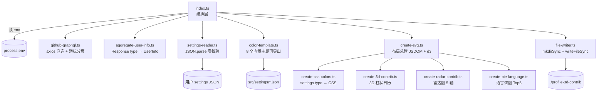

# github-profile-3d-contrib 技术演进 Spec

> 本文档是 `github-profile-3d-contrib` 后续重构的**技术规格说明书**,供评审、排期与逐步实施使用。
>
> **重要约定**:本文档及全部子文档中出现的所有代码、目录树、配置项、接口签名均为**计划内容,尚未实现**。
> 当前真实实现请以 `src/` 下源码为准。凡描述现状的部分,均已标注精确的文件与行号锚点。
>
> **分发契约变更(2026-11-12)**:仓库已不再提交 `dist/`,GitHub Action 改为 container action,
> CNB 与 GitHub 共用根目录 `Dockerfile`。下文及子文档中关于 `dist/` 一致性闸门、产物体积、
> `node24` + `dist/index.js` 运行时的描述均为**迁移前的历史/计划状态**;请以 `src/`、
> `Dockerfile`、`action.yml` 与 `.cnb.yml` 为准。

当前版本:`1.0.1`(2026-11-12,小版本演进起点;接管后首个版本为 `1.0.0`,2026-10-03)

> [!IMPORTANT]
> **本文档集的执行策略已随项目接管而调整。**
>
> 接管档案见 **[00-takeover.md](./00-takeover.md)** —— 它记录了已落地的改动、关键决策依据、
> CNB 平台的事实核查结论,以及未完成事项的交接说明。
>
> 简言之:阶段 0 的基础设施部分已随 `1.0.0` 完成;阶段 1~6 是接管后的长期演进计划,
> 不再以「回馈上游」为主线假设。阶段 2 及以后属于**永久分叉**内容。

## 文档索引

| # | 文档 | 内容 | 阅读时机 |
|---|---|---|---|
| 00 | [接管档案](./00-takeover.md) | 已执行的改动、双平台架构决策、CNB 事实核查、遗留缺陷与交接说明 | **先读这份** |
| 01 | 本文 | 现状分析、问题诊断、改造目标、预期收益、风险、优先级、阶段路线图 | **实施前必读** |
| 02 | [阶段 0:安全网](./01-phase0-safety-net.md) | CI 闸门、渲染层快照测试基线、测试类型检查、husky | 阶段 0 剩余项 |
| 03 | [阶段 1:止血与正确性](./02-phase1-correctness.md) | B1~B6 缺陷修复、JSON Schema 与设置校验器、错误码体系 | **建议优先执行** |
| 04 | [阶段 2:架构重构](./03-phase2-architecture.md) | 渲染器注册表、`LayoutModel` 与渲染流水线拆分 | 长期演进 |
| 05 | [阶段 3:配置体系与 API 层](./04-phase3-config-api.md) | 配置分层、`action.yml` inputs、`GitHubClient` 抽象 | 长期演进 |
| 06 | [阶段 4:性能与体验打磨](./05-phase4-perf-ux.md) | 依赖瘦身与体积优化、`LayoutOptions`、`l10n`、可访问性 | 长期演进 |
| 07 | [阶段 5:进阶能力](./06-phase5-advanced.md) | PNG 导出、API 缓存、多用户聚合等探索性能力 | 按需进入 RFC |
| 附录 | [目标架构蓝图](./appendix-target-architecture.md) | 目录树、核心接口签名、旧→新映射表、环境变量兼容表 | 阶段 2 前必读 |

阅读顺序建议:**接管档案 → 本文 → 附录 → 当前要执行的那一份阶段文档**。
附录是跨阶段共享的技术契约,阶段 2/3/4 的接口定义均以附录为准。

## 术语表

| 术语 | 含义 |
|---|---|
| 主题(type) | 由 `settings.type` 判别的 6 种渲染形态之一:`normal` / `season` / `rainbow` / `bitmap` / `pie_lang_only` / `radar_contrib_only` |
| Renderer | 渲染器。负责把 `UserInfo` + 设置渲染为一个 SVG。目标是消灭散落各处的 `settings.type` switch |
| `LayoutModel` | 布局模型。由 `LayoutEngine` 一次性算出的纯几何数据,与主题无关,被全部 Renderer 共享 |
| 快照基线 | 用 `spec/dummy-data.ts` 渲染出的 SVG 快照,用作「重构不改变输出」的判定门禁 |
| `UserInfo` | 领域模型。由 `aggregate-user-info.ts` 从 GraphQL 响应聚合而成 |
| 贡献日历 | GitHub 的 371 天贡献格子数据(`contributionCalendar`) |
| fail-fast | 尽早失败并给出可操作提示,而不是产出错误结果 |
| env | 环境变量,当前项目**唯一**的配置入口 |
| 阻塞式校验 | 校验不通过时直接终止并退出码非 0,与之相对的是仅告警 |

## 一、现状分析

### 1.1 项目定位

`github-profile-3d-contrib` 是一个 GitHub Action(Node 24 运行时,`dist/index.js` 单文件分发)。它从 GitHub GraphQL 拉取用户贡献数据,用 d3 + jsdom 渲染成 3D 贡献日历 SVG,写入固定目录后由用户工作流提交回仓库。

形态特征:纯 CLI 单进程、单次执行、无服务、无状态、无数据库。截至 `0.9.3`,源码 13 个 `.ts` 文件共 **1749 行**,测试 6 个 `.ts` 共 **2661 行**(其中 `spec/dummy-data.ts` 占 2359 行)。

### 1.2 分层与数据流



**既有优点**:依赖方向单向(`index` → 各模块),无循环依赖,模块边界清晰。这使得后续任何重构都可以逐模块替换而不牵动全局,是本 spec 敢于分阶段推进的基础。

### 1.3 能力盘点

| 能力 | 实现位置 | 状态 |
|---|---|---|
| 4 种日历主题 | `normal` / `season` / `rainbow` / `bitmap` | 成熟 |
| 2 种独立画布 | `pie_lang_only` / `radar_contrib_only` | 成熟 |
| 暗色模式 | `create-css-colors.ts:176` + `type.ts` 的 `darkMode` | 可用(`0.9.0` 新增) |
| 多语言标签 | `settings.l10n` | **覆盖不全**(饼图 `other` 不可本地化) |
| 历史年份 | `YEAR` env → GraphQL `from`/`to` | 可用,**无边界校验** |
| GitHub Enterprise | `GITHUB_ENDPOINT` env | 可用,但**模块加载期读取** |
| 仓库分页 | `github-graphql.ts:193-209` | 逻辑存在缺陷,见 B3 |
| 限流感知 / 重试 | — | **完全没有** |
| `action.yml` inputs | — | **没有**,仅 env |
| PNG 导出 / API 缓存 | — | **没有** |

固定输出 10 个文件:`profile-green-animate.svg`、`profile-green.svg`、`profile-season-animate.svg`、`profile-season.svg`、`profile-south-season-animate.svg`、`profile-south-season.svg`、`profile-night-view.svg`、`profile-night-green.svg`、`profile-night-rainbow.svg`、`profile-gitblock.svg`(`src/index.ts:63-110`)。使用自定义 settings 且缺省 `fileName` 时输出 `profile-customize.svg`(`src/index.ts:52`)。

### 1.4 工程质量基线

| 维度 | 现状 | 评价 |
|---|---|---|
| 源码规模 | 1749 行 / 13 文件 | 规模小,改造轻量 |
| 测试规模 | 4 个 spec,**渲染层 0 覆盖** | 严重短板 |
| CI | 仅 `build.yml`(`workflow_dispatch` 单触发)+ `latest-branch.yml`,**PR 无任何校验** | 严重短板 |
| TypeScript | `^4.2.4`(2021)配 `@types/node@^22.13.9` | 版本严重错配 |
| ESLint | `^8.56.0` | 已废弃版本线 |
| 分发体积 | `dist/index.js` **6.7 MB** | 偏大 |
| pre-commit | `package.json` 已配,但 **devDependencies 无 husky** | 死配置 |
| 产物一致性 | `build.yml` 仅手动触发,`dist/` 可能与源码不一致 | 无保障 |

## 二、问题诊断

### 2.1 架构层面

#### A1 主题类型是「封闭联合」,扩展成本被放大到 6 个文件

`settings.type` 的判定散落在 **3 个文件共 29 处**:

| 文件 | 行号 | 数量 |
|---|---|---|
| `src/create-3d-contrib.ts` | `156`、`234`、`253`、`255`、`257`、`259`、`264`、`283`、`285`、`287`、`289`、`305`、`329`、`331`、`333`、`335` | 16 |
| `src/create-css-colors.ts` | `19`-`22`、`27`、`42`、`55`、`107`、`134` | 9 |
| `src/create-svg.ts` | `27`、`30`、`63`、`75` | 4 |

其中 `create-3d-contrib.ts:253-261`、`:283-291`、`:329-337` 是**完全同构的三段**(顶面 / 左面 / 右面各一份颜色分支):

```typescript
if (settings.type === 'normal') {
    addNormalColor(topPanel, contribLevel, 'top');
} else if (settings.type === 'season') {
    addSeasonColor(topPanel, contribLevel, 'top', cal.date);
} else if (settings.type === 'rainbow') {
    addRainbowColor(topPanel, contribLevel, 'top', settings, week);
} else if (settings.type === 'bitmap') {
    addBitmapPattern(topPanel, contribLevel, 'top');
}
```

后果:新增一种主题类型必须同时修改 `type.ts`(接口 + 联合)、`create-3d-contrib.ts`(3 处)、`create-css-colors.ts`(CSS 生成分支)、`create-svg.ts`(画布尺寸)、新增 JSON + `color-template.ts`、`index.ts`(输出文件)——**共 6 个文件**。这是典型的单一 switch 横向扩散。

#### A2 配置入口单一且不可分层

`src/index.ts:16-17` 是全部的「命令行」处理:

```typescript
const userName = 3 <= process.argv.length ? process.argv[2] : process.env.USERNAME;
```

仅 env + 一个位置参数。没有 `action.yml` 的 `inputs`,没有 CLI 解析器,`--help` / `--out-dir` / `--theme` 一律不支持。校验只有 `Number.isNaN`,因此 `MAX_REPOS=-1`、`YEAR=3000` 均可通过。`--` 开头的参数会被当成用户名。

#### A3 编排层串行重复渲染 10 次

`src/index.ts:63-110` 连续 10 次 `createSvg`,每次都新建一个 JSDOM 实例、重新布局 371 天 × 3 个面、重新生成整套 CSS。几何计算与主题样式本应分离,当前是 10 倍冗余。

#### A4 类型信息未被封装,共享对象靠传参

`UserInfo` 在聚合后被 4 个渲染函数只读共享,尚可;但 `Settings` 在 `create-css-colors.ts` / `create-3d-contrib.ts` / `create-svg.ts` 中被反复做 `settings.type === ...` 判定(共 29 处),说明类型判别的责任没有收敛到单一位置。

#### A5 API 客户端职责过载,且 endpoint 在模块加载期求值

```typescript
// src/github-graphql.ts:4-5
export const URL =
    process.env.GITHUB_ENDPOINT || 'https://api.github.com/graphql';
```

`URL` 是模块级常量,在**模块加载时**求值。这导致测试无法在运行时切换 endpoint,只能依赖 `env` 在导入前设置。同一文件还同时承担请求构造、分页游标管理、错误透传,且:

- `errors?: [{ message: string; }]`(`:60-65`、`:75-80`)被错标为 **1 元组**,GitHub 返回多个 error 时类型撒谎;消费方 `aggregate-user-info.ts:36` 只取 `errors[0]`。
- 无重试、无超时(`AbortSignal`)、无 `rateLimit` 查询、无 HTTP 状态码分类。

### 2.2 代码质量与健壮性

#### B1 设置 JSON 零校验,静默产出空白图(最高危)

```typescript
// src/settings-reader.ts:4-10
export const readSettingJson = (filePath: string): type.SettingFile => {
    const content = readFileSync(filePath, { encoding: 'utf8', flag: 'r' });
    return JSON.parse(content) as type.Settings;
};
```

纯类型断言,无任何运行时校验。失败链条:

1. 用户 settings 中 `"type": "norml"`(拼写错误)
2. `create-svg.ts:27`、`:30` 两个判定均不命中 → 落入 3D 分支
3. `create-3d-contrib.ts:253-261`、`:283-291`、`:329-337` 三段分支全部不命中 → 柱子不被赋予任何 class
4. `create-css-colors.ts` 不生成任何 `.cont-*` 规则
5. **输出全透明 SVG,退出码 0,用户完全无从察觉**

这是本项目对用户体验伤害最大的缺陷。

#### B2 空日历导致启动即崩

`create-3d-contrib.ts:176` 有守卫 `if (userInfo.contributionCalendar.length === 0) { return; }`,但 `create-svg.ts:217` 无条件访问数组首元素:

```typescript
// src/create-svg.ts:217-221
const startDate = userInfo.contributionCalendar[0].date;
const endDate = userInfo.contributionCalendar[userInfo.contributionCalendar.length - 1].date;
```

当 `YEAR` 指向无数据年份时,`create3DContrib` 安全返回,随后在 `createSvg` 抛 `TypeError`。

#### B3 `MAX_REPOS` 语义失效

```typescript
// src/github-graphql.ts:193-209(节选)
if (result && result.user.repositories.nodes.length === maxReposOneQuery) {
    // maxRepos 仅为分页的停止阈值,并非真正的上限
}
```

两个具体问题:

1. 首页 100 个节点被**全量统计**,不做截断。`MAX_REPOS=10` 且用户有 30 个仓库时,30 个全部计入 star/fork。
2. `github-graphql.ts:110` 的 `commitContributionsByRepository(maxRepositories: 100)` 是**硬编码**,完全不受 `MAX_REPOS` 影响。对高产用户,语言饼图的数据本身就是不完整的。

#### B4 `fileName` 存在路径穿越

```typescript
// src/file-writer.ts:5-8
export const writeFile = (fileName: string, content: string): void => {
    mkdirSync(OUTPUT_FOLDER, { recursive: true });
    writeFileSync(`${OUTPUT_FOLDER}/${fileName}`, content);
};
```

`fileName` 直接来自用户 JSON 且未做校验,`"fileName": "../../.github/workflows/x.yml"` 可写出目录之外。虽以自我威胁为主(配置来自用户自己的仓库),但在 reusable workflow 场景下是真实的加固缺口。同文件 `mkdirSync` 在一次运行中被调用 10 次,属冗余。

#### B5 错误日志可能泄露私有信息

```typescript
// src/aggregate-user-info.ts:34-40
if (!response.data) {
    if (response.errors && response.errors.length) {
        throw new Error(response.errors[0].message);
    } else {
        throw new Error('JSON\n' + JSON.stringify(response, null, 2));
    }
}
```

失败时整体 dump GraphQL 响应。**私有仓库名不是 secret**,GitHub 日志脱敏不会遮蔽它,而 profile 仓库的 Actions 日志默认公开。

#### B6 其他

- `create-svg.ts:147-148` 连续两次 `.attr('text-anchor', 'start')`,重复语句。
- `settings-reader.ts:9` 之外,`index.ts` 的数值校验仅 `Number.isNaN`,`MAX_REPOS=-1`、`YEAR=3000` 均通过。
- `tsconfig.json` 的 `include` 为 `["src/**/*"]` → **`spec/` 从不被类型检查**。
- `package.json` 的 jest `testMatch` 为 `["**/spec/*.(spec|test).(ts|js)"]`,`.` **未转义**,会匹配任意字符。
- `clean` 脚本为 `rimraf --glob "dist/*"`,**不清理 `dist0`**,而 `build` 为 `ncc build dist0/index.js`,残留文件可能被一并打包。
- `index.ts:118` 的 `void main();` 在模块加载时即执行,`index.ts` 无法被安全 import。

### 2.3 功能与体验

#### C1 `l10n` 覆盖不全

`type.ts` 中 `l10n` 被**重复声明**两次:`RadarContribSettings`(5 键)与 `BaseSettings`(6 键,多 `contrib`)。雷达图 5 个轴标签、总量标签可本地化,但 `create-pie-language.ts:4` 的 `const OTHER_NAME = 'other';` **无法本地化**。

#### C2 无 `action.yml` inputs

`action.yml` 只有 `name` / `description` / `author` / `runs` / `branding`。用户必须写 `env:` 块,无法使用 `with:` 的自文档化语法,也无法在 Action 页面看到可填参数。

#### C3 布局完全硬编码

- `create-svg.ts:10-11`:`const width = 1280;` / `const height = 850;`
- `create-3d-contrib.ts:5`:`const ANGLE = 30;`
- `create-3d-contrib.ts:185`:`const dx = width / 64;` —— 隐含「53 周 + 边距」的硬假设
- `create-3d-contrib.ts:204`:`const calHeight = Math.log10(cal.contributionCount / 20 + 1) * 144 + 3;` —— 魔数

想换尺寸 / 换透视 / 换柱高曲线必须改代码。

#### C4 无可访问性

生成的 SVG 没有 `role="img"`、`<title>`、`<desc>`,屏幕阅读器无法解读。

#### C5 无 schema 支撑的编辑体验

README 让用户「参考 `sample-settings/*.json` 和 `src/type.ts`」,但**没有 JSON Schema**。VS Code 中写 settings JSON 零补全、零校验,与 B1 叠加后形成灾难性体验:写错了不报错,只给你一张空白图。

#### C6 依赖体积浪费

`dist/index.js` 6.7 MB。5 个文件均 `import * as d3 from 'd3'` 全量引入。bundle 内实测存在**完全未使用**的 `d3-geo`、`d3-force`、`d3-drag`、`d3-zoom`。实际用到的仅 `d3-selection`、`d3-shape`、`d3-path`、`d3-color`、`d3-interpolate`。`jsdom` 则仅用于给 `d3.select` 提供一个 DOM 容器(`create-svg.ts:35-38`)。

#### C7 缺少能力

无 CLI 主题选择、无 `--dry-run`、无 PNG 导出、无 GitHub API 结果缓存、无速率限制感知、无法在单图中聚合多用户。

## 三、改造目标

| # | 目标 | 可验证含义 |
|---|---|---|
| G1 | **正确性** | 任何配置错误都在 1 秒内以可读信息失败,绝不产出静默错误或空白 SVG |
| G2 | **可扩展性** | 新增主题 / 新增配置项的改动面从「跨 6 文件」收敛为「新增 1 文件」 |
| G3 | **性能与体积** | 主流程渲染耗时与产物体积显著下降,Action 启动更快 |
| G4 | **工程基线** | PR 上有自动化闸门,工具链版本自洽 |

## 四、预期收益

| 维度 | 现状 | 目标 | 预期收益 |
|---|---|---|---|
| 产物体积 | 6.7 MB | 1.5~2 MB | Action 下载与冷启动显著加快 |
| 渲染耗时 | 10 次全量渲染 | 1 次布局 + N 次样式 | 3~6 倍提速 |
| 新增主题成本 | 改 6 个文件 | 加 1 个文件 + 注册表一行 | 扩展效率提升约 6 倍 |
| 渲染层测试覆盖 | 0% | ≥ 60% | 重构安全性保障 |
| 配置错误可见性 | 静默失败 | 行号级精确报错 + schema 校验 | 体验质变 |
| 可访问性 | 无 | `role` / `title` / `desc` | SVG 可被读屏软件解读 |
| 依赖冗余 | 引入 4 个未用 d3 子模块 + jsdom | 按需引入 | 体积与安全面收敛 |

> 上表为**目标值**。阶段 4 将给出逐项验证方法与实测口径;在实测完成前,评审时不应将其视为已达成结论。

## 五、风险表

| 风险 | 等级 | 说明 | 缓解措施 |
|---|---|---|---|
| 渲染输出变化导致全量 diff 抖动 | **高** | 重构 D3 绘制顺序会改变 SVG 属性顺序与浮点精度,导致所有用户 README 图片**一次性全量重绘**,产生大量无意义 commit | 阶段 0 先建立 SVG 快照基线;阶段 2 每迁移一个 renderer 即比对,不一致则阻断合并;切换前用 `docs/demo/` 下 10 个 SVG 人工比对 |
| 引入 `ajv` / `linkedom` 新依赖 | 中 | 与 `0.9.2` 「为规避 `undici` 漏洞移除依赖」的既定策略相悖 | schema 校验**先用零依赖手写 validator**;`ajv` 列为可选方案;`linkedom` 先做兼容性 spike,不过则维持现状 |
| TypeScript 4.2 → 5.x 类型收紧 | 中 | 升级可能触发大量类型错误 | 独立 PR,只做版本升级不做逻辑改动;`skipLibCheck` 已开启可缓解大部分 |
| 重构期产物与社区 `@latest` 使用方式不匹配 | 中 | 已有大量用户通过 `@latest` 引用,中间态会直接暴露 | 分阶段发布,`latest` 分支仅在 minor 版本时更新;patch 版本不含重构 |
| JSON Schema 使旧 settings JSON 失效 | 中 | 存量用户的 JSON 可能不符合新 schema | 初期仅**告警不阻断**,下个 minor 版本转为阻断 |
| `MAX_REPOS` 语义修正导致数字变小 | 中 | 部分用户 star / fork 数字将**变小**(此前虚高) | 在 CHANGELOG 中显式说明;README 环境变量章节补充示例 |
| 性能优化引入渲染差异 | 低 | 复用布局后若 `LayoutModel` 非纯函数会产生漂移 | 约束 `LayoutEngine.layout()` 为纯函数,相同输入必须产出相同输出 |
| 11 份多语言 README 同步成本 | 低 | 文档重构工作量 | 排在最后,可通过流水线化延后 |

## 六、优先级矩阵

| 优先级 | 事项 | 理由 |
|---|---|---|
| **P0** | JSON Schema + 设置校验(修 B1) | 当前最大用户伤害点,静默产出空白图 |
| **P0** | `ci.yml`:PR 闸门 + `dist/` 一致性 | 一切重构的前置条件 |
| **P0** | 空日历 fail-fast(修 B2) | 崩溃级缺陷,改动极小 |
| **P0** | 修 B3 `MAX_REPOS` 语义 | 数据正确性 |
| **P0** | 修 B5 隐私泄露 | 输出安全 |
| **P0** | 工具链升级(TS 5 / ESLint 9 / husky) | 后续所有工作的地基 |
| **P1** | 渲染器注册表(修 A1) | 架构核心,收益最大 |
| **P1** | 配置分层 + `action.yml` inputs + CLI(修 A2) | 可扩展性与上手体验 |
| **P1** | `GitHubClient` 抽象 + 重试 / 限流(修 A5) | 稳定性 |
| **P1** | 输出层安全与幂等(修 B4) | 安全加固 |
| **P1** | 渲染流水线拆分(修 A3) | 性能,且为注册表落地前提 |
| **P1** | 渲染层测试补齐 | 保障上述各项正确性 |
| **P1** | 依赖瘦身与体积优化 | 收益可见,已在阶段 4 前置评估 |
| **P2** | `l10n` 补全(修 C1) | 体验完善 |
| **P2** | 可访问性增强(修 C4) | 体验完善 |
| **P2** | `LayoutOptions` 参数化(修 C3) | 高级定制 |
| **P2** | `--dry-run` / API 缓存 / PNG 导出 | 锦上添花 |
| **P3** | 多用户聚合 | 探索性 |
| **P3** | 11 份 README 流水线化 | 工程效率 |

## 七、阶段路线图

> **阶段编号说明**:本 spec 沿用首轮调研报告的编号,**阶段 0 ~ 阶段 5,共 6 个阶段,编号连续**。报告中曾被口头表述为「5 个阶段」,但实际划分为 6 个,本文不做合并,以免 P1 与 P2/P3 混入同一批次而失去优先级意义。

| 阶段 | 主题 | 优先级 | 工期 | 目标版本 | 核心交付 |
|---|---|---|---|---|---|
| [0](./01-phase0-safety-net.md) | 安全网 | P0 | 1~2 周 | 不发版 | CI 闸门、快照基线、测试类型检查、husky |
| [1](./02-phase1-correctness.md) | 止血与正确性 | P0 | 2 周 | patch | B1~B6 修复、schema 校验器、错误码体系 |
| [2](./03-phase2-architecture.md) | 架构重构 | P1 | 5 周 | minor | 渲染器注册表、`LayoutModel`、流水线拆分 |
| [3](./04-phase3-config-api.md) | 配置体系与 API 层 | P1 | 4 周 | minor | config 分层、inputs、`GitHubClient` |
| [4](./05-phase4-perf-ux.md) | 性能与体验打磨 | P1/P2 | 4 周 | minor | 体积优化、`LayoutOptions`、`l10n`、可访问性 |
| [5](./06-phase5-advanced.md) | 进阶能力 | P2/P3 | 待定 | 待定 | PNG、缓存、多用户聚合(走 RFC) |

### 接管后的执行状态(2026-10-03)

| 阶段 | 状态 | 说明 |
|---|---|---|
| 0 安全网 | 🟡 **部分完成** | `.gitattributes`、`ci.yml`(dist 一致性阻塞 + 质量观察)、`release.yml`、`build.yml` 修正已随 `1.0.0` 落地。**剩余**:渲染层快照测试、`spec/` 类型检查、husky |
| 1 止血与正确性 | ⬜ 未开始 | 6 个遗留缺陷全部未修。`B1`(静默产出空白图)影响最大,建议优先,并考虑向上游提 PR |
| 2 架构重构 | ⬜ 未开始 | 属**永久分叉**内容,不再以「回馈上游」为目标 |
| 3 配置体系与 API 层 | ⬜ 未开始 | 依赖阶段 2 |
| 4 性能与体验打磨 | ⬜ 未开始 | 依赖阶段 2 |
| 5 进阶能力 | ⬜ 未开始 | 每项独立走 RFC |

> ⚠️ **阶段 2 启动前必须先完成阶段 0 的快照测试。**
> 接管已建立 `dist/` 一致性校验,但那只能保证「产物与源码同步」,
> **无法**保证「重构前后产物相同」。后者才是阶段 2 的硬约束,只能靠渲染层快照测试保障。

### 阶段衔接关系


依赖说明:

- **阶段 2 强依赖阶段 0**。没有快照基线,重构后无法判定 SVG 输出是否漂移,「不改变输出」这一硬约束就不可验证。这是整个路线图最关键的一条依赖。
- 阶段 1 与阶段 2 在阶段 0 完成后可**并行**,但两者都会改动 `create-svg.ts` 与 `github-graphql.ts`,建议串行或严格分文件提交。
- **阶段 4 依赖阶段 2**。依赖瘦身需要在 `Renderer` 接口稳定后进行,否则白做。
- 阶段 3 与阶段 4 依赖阶段 2 的 `Renderer` / `LayoutModel` 契约,三者共用[附录](./appendix-target-architecture.md)中的接口定义,不允许各自另立。
- 阶段 5 不阻塞任何前序阶段,按社区反馈进入 RFC。

### 最小可行起步

若资源有限,**只做以下三件事**即可取得约 80% 的价值,且全部低风险、不改架构:

1. **JSON Schema + 设置校验**(阶段 1)—— 修掉最伤害用户的静默失败,同时提供编辑器补全
2. **`ci.yml` + 渲染层快照测试**(阶段 0)—— 建立后续所有工作的安全网
3. **修 B2 / B3 / B5**(阶段 1)—— 三处小改动,分别消除崩溃、数据失真、隐私泄露

这三项可在 2~3 周内完成并作为独立 patch 版本发布。阶段 2 才是真正动架构的部分,应在安全网就位后再启动。

## 八、环境变量兼容承诺

本 spec **不删除、不重命名、不改变语义**以下六个既有环境变量,完整兼容表(旧行为 / 新行为 / 是否破坏 / 迁移建议)见[附录](./appendix-target-architecture.md)。

| 环境变量 | 阶段 1 | 阶段 2 | 阶段 3 |
|---|---|---|---|
| `GITHUB_TOKEN` | 保留 | 保留 | 保留,并新增 `inputs.token` |
| `USERNAME` | 保留 | 保留 | 保留,新增优先级更高的 CLI 位置参数 |
| `MAX_REPOS` | **语义修正**(真正截断) | 保留 | 保留,新增 `inputs.max-repos` 与范围校验 |
| `SETTING_JSON` | 保留 | 保留 | 保留,新增 `inputs.settings-json` |
| `GITHUB_ENDPOINT` | 保留 | 保留 | 保留(改为构造注入,行为不变) |
| `YEAR` | 保留 + 边界校验 | 保留 | 保留,新增 `inputs.year` |

唯一的**破坏性变更**是 `MAX_REPOS` 的语义修正:此前它只是分页停止阈值,修正后是真正的仓库数上限,因此部分用户的 star / fork 数字会变小。这是修正而非退化,需在 CHANGELOG 中显式说明。
